# Mi Estudio 🎒

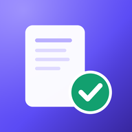

**App publicada:** <https://wlacaze-git.github.io/mi-estudio/>

| Hoy | Perfil y logros |
| --- | --- |
| 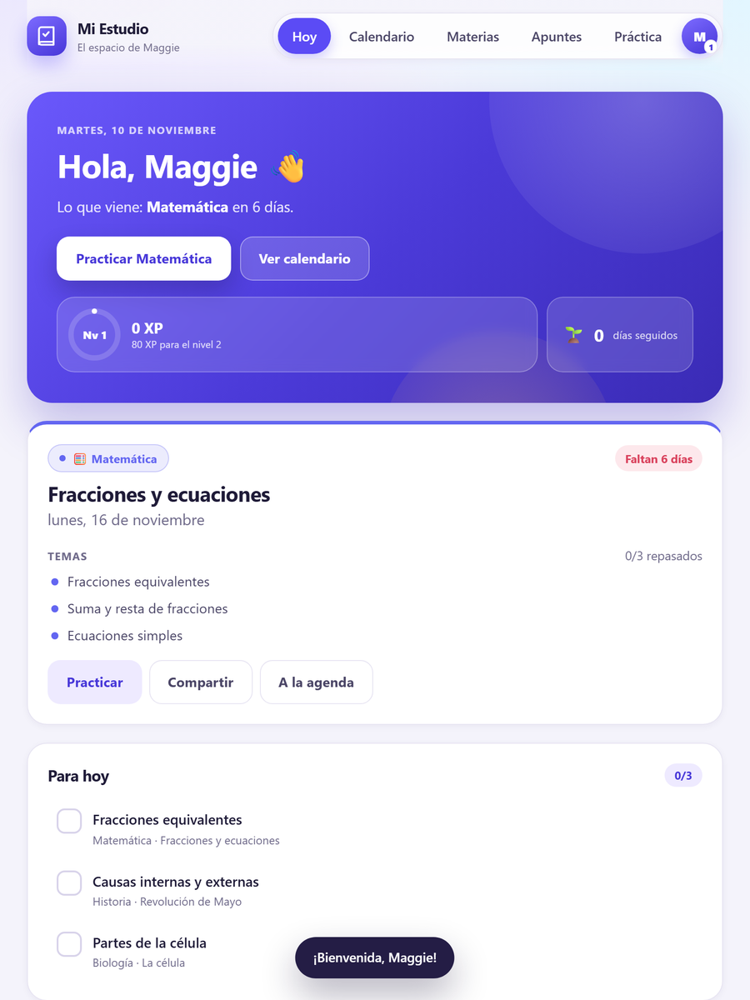 | 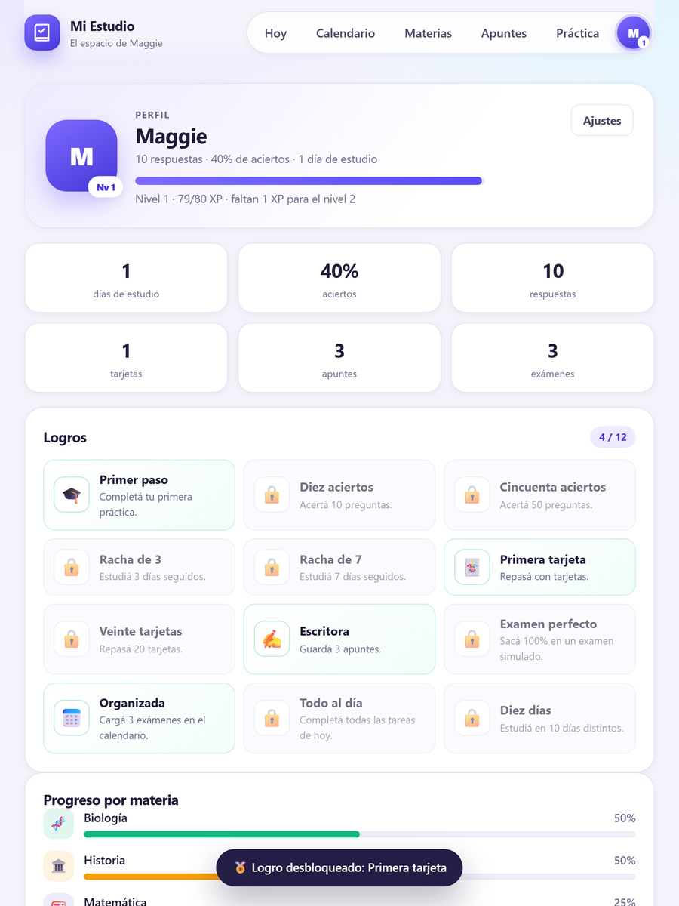 |

| Tarjetas | Apuntes |
| --- | --- |
| 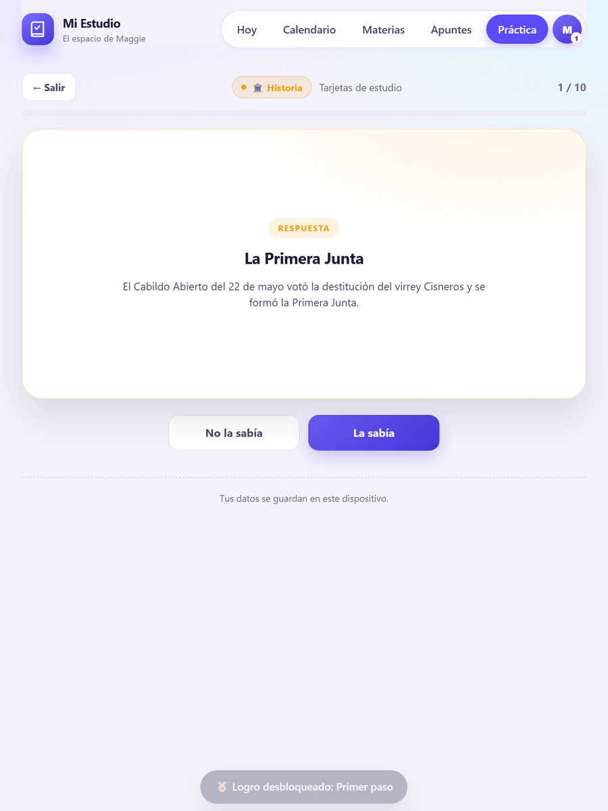 | 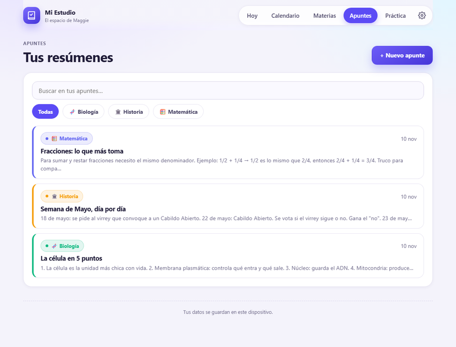 |

| Apunte con foto |
| --- |
| 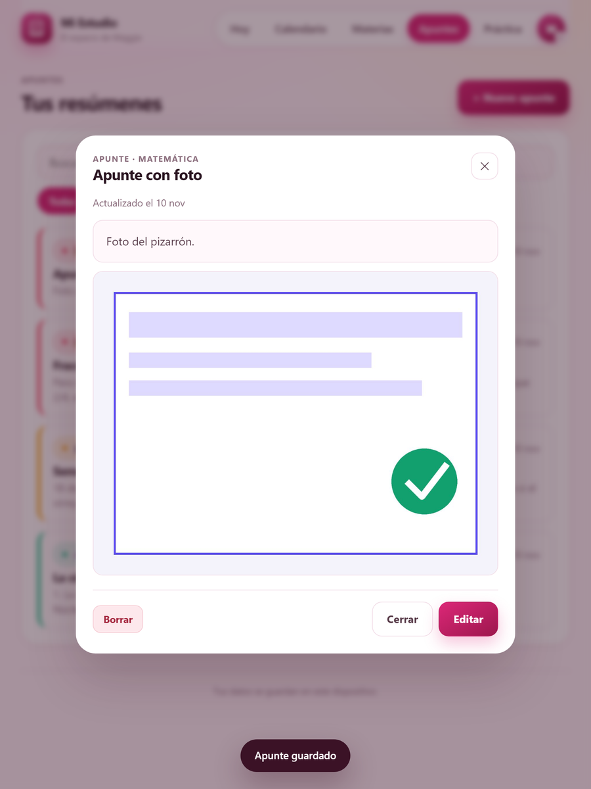 |

| Horario de la semana |
| --- |
| 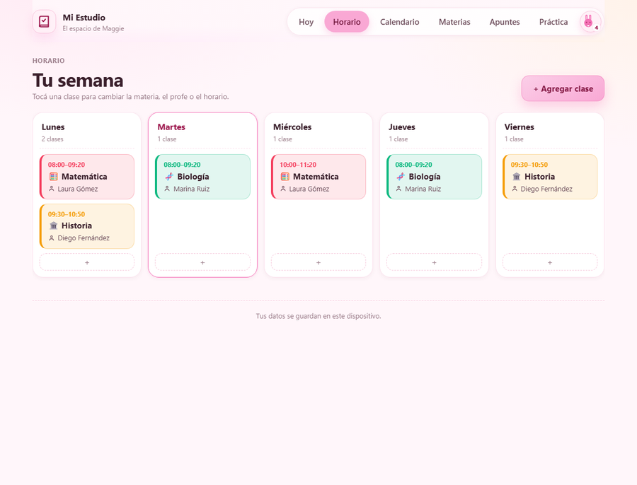 |

| Nuevo plan: para qué es | Nuevo plan: fecha y fotos |
| --- | --- |
| 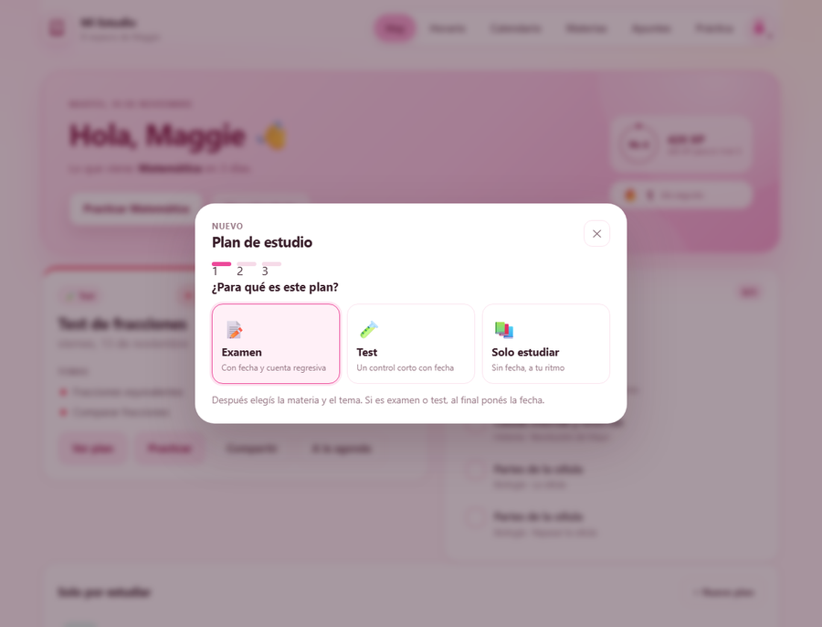 | 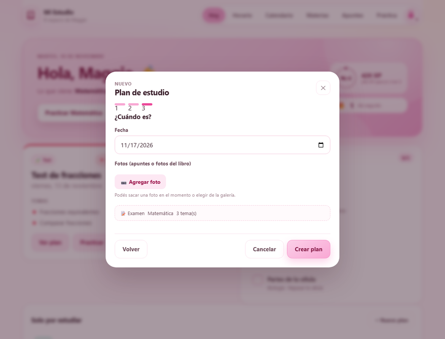 |

| Plan creado |
| --- |
| 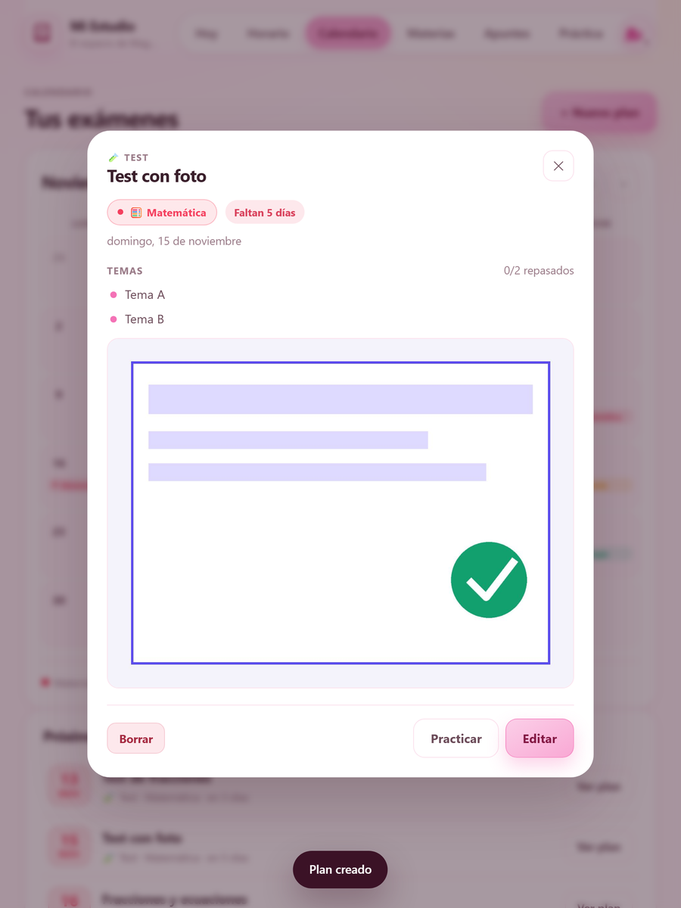 |

App para estudiar desde el iPad, en **rosa claro con animal print** (manchas rosadas sobre blanco, como el ícono): calendario de exámenes, plan de repaso, preguntas de multiple choice, tarjetas y apuntes. Funciona sin internet una vez instalada y guarda todo en el dispositivo.

Hecha para usarse en familia: Maggie (o quien la use) carga sus materias, exámenes y preguntas; la app le avisa qué le toca estudiar cada día y le toma examen.

---

## Qué hace

| Sección | Para qué sirve |
| --- | --- |
| **Hoy** | Saludo, nivel y XP, racha de días estudiando, próximo examen con cuenta regresiva, **clases del día** y las tareas de repaso. |
| **Horario** | La semana completa: materia, día, hora y **profesor/a** de cada clase. |
| **Calendario** | Vista mensual con los exámenes y tests marcados por materia. Al tocar un día se ve el detalle y se puede editar. |
| **Materias** | Cada materia con sus preguntas, exámenes y apuntes, más el porcentaje de aciertos. |
| **Apuntes** | Resúmenes por materia, con buscador, filtro y **fotos** (del pizarrón, la carpeta o el libro). |
| **Práctica** | Examen simulado (10 preguntas mezcladas), tarjetas de estudio y “repasar las que fallé”. |
| **Perfil** | Nivel, XP, racha, estadísticas, 12 logros, **tu animal** (que mejora con el nivel) y las personas que usan la app. |
| **Ajustes** | Nombre, backup, importar, exportar exámenes al Calendario del iPad y borrar datos. |

Extras:

- **Plan de estudio guiado**: elegís para qué es (examen, test o solo estudiar), la asignatura y el tema; podés sumar fotos de apuntes o del libro; y si es examen o test, al final ponés la fecha. Los planes sin fecha quedan en “Solo por estudiar”.
- **Avatar animal**: el avatar es un animal rosa que va mejorando con el nivel: caracol → gato → perro → conejo → zorro → jirafa → león → **guepardo** (el mejor). Cambia solo al subir de nivel y en el perfil se ve la escalera completa.
- **Horario siempre a mano**: la semana completa con materia, hora y profe; en “Hoy” ves las clases del día y se resalta la que está en curso.
- **Nivel, XP y logros**: ganás XP por cada respuesta (10 si está bien, 3 si no), tarjeta (6 / 2) y tarea del plan (8). Los niveles suben y hay 12 medallas para desbloquear, con aviso cuando cae una nueva.
- **Fotos en los apuntes**: desde el editor tocás “Agregar foto” y podés sacarla en el momento o elegir de la galería. Se achican solas (máx. 1400 px) para ocupar poco, se guardan en el iPad y se ven grandes dentro del apunte (tocás para ampliar).
- **Plan de estudio automático**: reparte los temas de cada examen entre hoy y la víspera, y los muestra como checklist en “Hoy”.
- **Tarjetas**: se arman solas con las preguntas cargadas (pregunta adelante, respuesta atrás).
- **Avisos en el iPad**: se exportan los exámenes a la app Calendario (`.ics`) con recordatorios 2 días antes y la víspera a las 18:00.
- **Compartir**: manda el examen por WhatsApp o por donde quieras con el botón “Compartir”.
- **Offline**: una vez abierta, queda cacheada y funciona sin conexión.
- **Backup**: descarga un `.json` con todo y se puede volver a importar.

---

## Probarla en la computadora

Los archivos son estáticos, pero hay que servirlos con un servidor (no alcanza con abrir `index.html` con doble clic, porque usa módulos de JavaScript).

**Opción fácil (Windows):** doble clic en `iniciar.cmd`. Abre `http://localhost:8080` en el navegador.

**Opción manual:**

```bash
python -m http.server 8080
# o
npx http-server -p 8080
```

Después abrí <http://localhost:8080>.

> Probala en Chrome o Edge con la vista de iPad (F12 → modo dispositivo, 834 × 1112) para verla como en el iPad.

---

## Instalarla en el iPad

1. Abrí el link de la app en **Safari**.
2. Tocá **Compartir** (el cuadrado con la flecha hacia arriba).
3. Elegí **“Agregar a pantalla de inicio”**.
4. Listo: aparece el ícono y se abre a pantalla completa, como una app.

> Importante: usala desde el ícono instalado. Safari puede borrar los datos de sitios que no se usan por mucho tiempo; las apps agregadas a la pantalla de inicio están exentas.

---

## Publicarla gratis (link para el iPad)

La app es 100 % estática: cualquier hosting gratuito sirve. Recomendado **Netlify Drop** porque no requiere instalar nada:

1. Entrá a <https://app.netlify.com/drop>.
2. Arrastrá **la carpeta completa** del proyecto (o el `.zip` descomprimido).
3. Te da un link tipo `https://algo-random.netlify.app`.
4. Abrí ese link en el iPad y agregalo a la pantalla de inicio.
5. Si querés que el link no cambie, creá una cuenta gratis y reclamá el sitio (Site settings → Change site name).

Alternativas igual de válidas:

- **GitHub Pages**: subís el repo, Settings → Pages → Deploy from branch `main` / root. Queda en `https://usuario.github.io/repo/`.
- **Cloudflare Pages**: conectás el repo o subís la carpeta; da HTTPS y dominio propio gratis.
- **Vercel**: `npx vercel` y listo.

Cada vez que quieras actualizar la app, volvés a subir la carpeta (o hacés push al repo).

---

## Cómo se carga el contenido

- **Plan de estudio**: Hoy o Calendario → *+ Nuevo plan*. Primero elegís **para qué es** (examen, test o solo estudiar), después la **asignatura** y el **tema** (podés listar varios temas para repartir), y al final la **fecha** si es examen o test, más fotos si querés. Los planes sin fecha aparecen en “Solo por estudiar” y también generan tareas diarias.
- **Clase del horario**: Horario → *+ Agregar clase* (o el **+** del día). Materia, día, desde/hasta, profesor/a y aula. Se puede tocar cualquier clase para editarla o borrarla.
- **Materia**: Materias → *+ Agregar materia* (nombre, emoji y color).
- **Pregunta**: Materias → entrá a la materia → *+ Nueva pregunta*. Escribís la pregunta, 4 opciones (podés agregar hasta 6), marcás la correcta y una explicación.
- **Apunte**: Apuntes → *+ Nuevo apunte*. Título y texto libre.

Los datos de ejemplo se pueden borrar desde **Ajustes → Borrar los datos de ejemplo**.

---

## Notificaciones: cómo funciona de verdad en el iPad

Una web app no puede programar notificaciones locales como una app nativa. La solución implementada:

1. **Ajustes → “Exportar exámenes a la agenda (.ics)”**.
2. Se descarga un archivo; abrilo y elegí **Agregar todo** al Calendario.
3. Cada examen queda como evento de todo el día con **dos avisos**: 2 días antes y la víspera, a las 18:00.

Además, al abrir la app siempre ves la cuenta regresiva y “Para hoy”.

Si más adelante querés notificaciones push reales, hace falta un servidor (y en iOS solo funcionan con la app instalada). Es el paso siguiente si les sirve.

---

## Tu animal

El avatar cambia según el nivel: cuanto mejor te va, mejor es el animal. Todos en rosa, y el guepardo es el premio mayor.

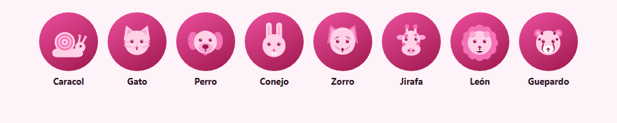

| Nivel | Animal |
| --- | --- |
| 1 | Caracol |
| 2 | Gato |
| 3 | Perro |
| 4 | Conejo |
| 5 | Zorro |
| 6 | Jirafa |
| 7 | León |
| 8 en adelante | Guepardo |

---

## Varias personas en el mismo iPad

La app guarda **un espacio separado por persona**. Cada una tiene sus propias materias, exámenes, preguntas, apuntes, XP, racha y logros; nada se mezcla.

- **Agregar**: Perfil → *+ Agregar persona* → nombre. Arranca con su espacio vacío.
- **Cambiar**: Perfil → *Cambiar* al lado del nombre. Vuelve a “Hoy” con los datos de esa persona.
- **Borrar**: Perfil → ✕ (solo se pueden borrar las personas que no están activas; siempre queda al menos una).

Todo queda en el iPad, en almacenamiento separado por persona dentro del navegador.

---

## Datos, backup y privacidad

- Todo se guarda en el **dispositivo** (localStorage para los datos y IndexedDB para las fotos), separado por persona. No hay cuentas, servidores ni analytics: nada sale del iPad.
- **Ajustes → Descargar backup (.json)** guarda un archivo con **la persona activa**, incluidas sus fotos. **Importar backup** lo restaura en la persona activa (sirve para pasar de un dispositivo a otro).
- Si borrás datos del navegador o desinstalás la app, se pierde lo que no esté respaldado.

---

## Estructura del proyecto

```
index.html            estructura de la app
styles.css            estilos (pensados para iPad)
app.js                navegación, eventos y estado de las pantallas
js/dates.js           fechas, calendario mensual y exportación .ics
js/store.js           estado + guardado en localStorage
js/seed.js            datos de ejemplo
js/quiz.js            motor de preguntas, tarjetas y resultados
js/views.js           HTML de cada pantalla
js/ui.js              helpers de interfaz (modales, toasts, íconos)
js/images.js          fotos de los apuntes (compresión + IndexedDB)
manifest.webmanifest  configuración PWA
sw.js                 service worker (funcionamiento offline)
icons/                íconos de la app
tools/make_icons.py   regenera los íconos PNG
iniciar.cmd           servidor local para Windows
```

Tests (desarrollo): `.dev/test.mjs` usa jsdom (`npm i jsdom` dentro de `.dev`) y `.dev/cdp.mjs` maneja Chrome por CDP. No son necesarios para usar la app.

---

## Publicar en la App Store (si algún día lo quieren)

No es necesario para usar la app, pero se puede:

- Requiere **Apple Developer Program**: 99 USD/año.
- Hay que envolver la web en una app nativa (Capacitor o similar) y compilar con Xcode (o un servicio en la nube).
- Pasa por **revisión de Apple** (puede tardar días y puede rechazarse una app de uso personal por “poca funcionalidad”).
- Mientras tanto, la versión instalable desde Safari da el 95 % de la experiencia: ícono propio, pantalla completa y offline.

---

## Ideas para la próxima

- Notificaciones push (requiere backend).
- Sincronizar entre iPad y computadora (requiere backend o iCloud).
- Importar preguntas desde un archivo o pegar un texto y que se armen solas.
- Modo “examen con tiempo” y estadísticas por tema.
- Apuntes con formato (negritas, listas, imágenes).
